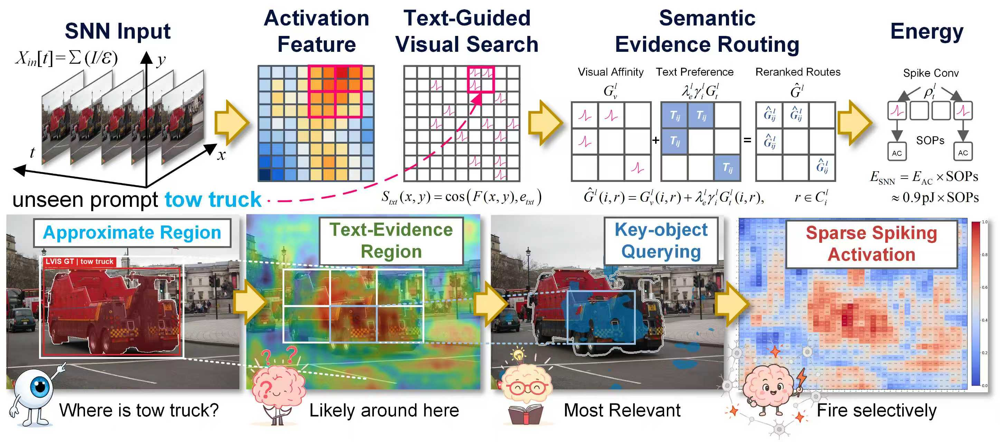

# OmniSpike

## Overview

<p align="center">
  
</p>

<h1 align="center">Language-Guided Sparse Spiking Computation for Seeing Anything</h1>

<p align="center"><strong>OmniSpike</strong></p>

### Abstract

Open-world perception extends object recognition and localisation beyond the category space represented during training. Existing open-world detectors provide such semantic flexibility, but their dense visual processing incurs substantial computational and energy costs. Spiking neural networks offer a sparse, event-driven alternative with the potential for greater efficiency. However, existing spiking neural network detectors remain confined to fixed label spaces, with their sparse activity organised independently of the language-defined target. Open-world perception therefore requires language to guide not only what the model recognises, but also which visual evidence is retained under a fixed computation budget. To bridge this gap, we introduce **OmniSpike**, a directly trained spiking neural network framework that unifies open-world object detection and instance segmentation. OmniSpike incorporates Semantic Evidence Routing (SER), which leverages language guidance to route multi-scale spiking features towards semantically relevant regions while preserving visually plausible candidates. A key-object querying mechanism selects task-relevant evidence for sparse aggregation, refining the shared visual features used for joint object detection and instance segmentation. Extensive experiments show that OmniSpike achieves state-of-the-art performance among directly trained spiking neural network detectors, reaching **51.6** box AP and **42.2** mask AP on COCO and **33.6**/**22.5** box/mask AP on zero-shot LVIS. On event benchmarks, OmniSpike consistently outperforms existing methods in both closed-set instance segmentation and cross-dataset transfer under point and box prompts. OmniSpike extends sparse spiking perception beyond fixed label spaces to open-world detection and instance segmentation.

### Authors

**Ziqi Li**<sup>1,2</sup>, **Tao Gao**<sup>1,*</sup>, **Shutao Li**<sup>1,*</sup>, **Bochen Zhang**<sup>1</sup>, **Yuanbo Wen**<sup>1</sup>, **Ting Chen**<sup>1</sup>, **Xin Zhang**<sup>2</sup>, **Zeyu Xiao**<sup>2</sup>, **Yuchao Dai**<sup>3</sup>, and **Robby Tan**<sup>2</sup>

<sup>*</sup>Corresponding authors.

1. Chang'an University, Xi'an 710064, China<br>
2. National University of Singapore, Singapore 117583, Singapore<br>
3. Northwestern Polytechnical University, Xi'an 710072, China

| Author | Contact |
|---|---|
| Ziqi Li | `lzq@chd.edu.cn` |
| Tao Gao | `gtnwpu@126.com` |
| Shutao Li | `shutao_li@hnu.edu.cn` |
| Bochen Zhang | `zbc@chd.edu.cn` |
| Yuanbo Wen | `wyb@chd.edu.cn` |
| Ting Chen | `tchenchd@126.com` |
| Xin Zhang | `x.zhang@u.nus.edu` |
| Zeyu Xiao | `zeyuxiao1997@163.com` |
| Yuchao Dai | `daiyuchao@nwpu.edu.cn` |
| Robby Tan | `robby.tan@nus.edu.sg` |

## System Requirements

- Python 3.10 or 3.11
- A PyTorch installation matching the available CPU or CUDA environment
- A GPU is recommended for training and full-resolution evaluation

## Installation Guide

Install the project and its reviewer-facing dependencies with:

```powershell
python -m pip install -e .
python -m pip install -r requirements-reviewer.txt
```

## Usage

### Verify model construction

The following command constructs the target S-scale configuration and checks the custom head, regression setting,
end-to-end setting, prediction branches, and Proto output without training:

```powershell
python verify_0824_direct_text_route_ser.py
```

### Prediction, training, and validation

The reviewer-facing entry points are provided at the repository root:

```powershell
python predict.py --source path/to/image.jpg --classes person,car
python val.py --data path/to/dataset.yaml
python train.py --data path/to/dataset.yaml --epochs 1
```

For an offline code-and-weight smoke test that does not download the optional text encoder, add
`--offline-smoke` to each command. This mode checks model construction, checkpoint loading, data loading, the forward
pass, validation, and one training epoch with deterministic random text features; it is not a semantic-accuracy
evaluation.

The entry points write temporary outputs outside this repository by default. Generated experiment outputs are not part
of this release.

## Weights

The pretrained OmniSpike weights can be downloaded from [Google Drive](https://drive.google.com/file/d/1AY8dCsL_1-RV-vStaYOe6D74Y5COflP1/view?usp=drive_link).

## Model Configuration

The retained implementation is centered on the S-scale configuration:

`omnispike-text-route-bira-reg16.yaml`

The model keeps the directly trained spiking backbone and neck, the joint detection and instance-segmentation head,
Semantic Evidence Routing, text-conditioned feature routing, and the parser/registration logic required to construct
the target network. The P4 and P5 features are refined by the text-route module and shared by the classification,
box-regression, and mask-coefficient branches, while the Proto branch reads the original P3 feature.

## Project Structure

| Purpose | Path |
|---|---|
| Overview figure | `assets/omnispike_overview.jpg` |
| Target model configuration | `omnispike-text-route-bira-reg16.yaml` |
| SNN backbone and neck blocks | `yolo_spikformer.py` |
| Joint detection and segmentation head | `head.py` |
| Semantic Evidence Routing | `text_guided_ser.py` |
| Prediction entry point | `predict.py` |
| Training entry point | `train.py` |
| Validation entry point | `val.py` |
| Model verification | `verify_0824_direct_text_route_ser.py` |
| Structural tests | `tests/test_direct_text_route_ser_spikes.py` |

## Dataset Link

The datasets analysed in this study are publicly available from their respective providers:

- [Objects365](https://www.objects365.org/)
- [GQA](https://cs.stanford.edu/people/dorarad/gqa/)
- [Flickr30k Entities](https://bryanplummer.com/Flickr30kEntities/)
- [LVIS](https://www.lvisdataset.org/dataset)
- [COCO](https://cocodataset.org/)
- [DSEC](https://dsec.ifi.uzh.ch/)
- [Prophesee Gen1 Automotive Detection Dataset](https://www.prophesee.ai/2020/01/24/prophesee-gen1-automotive-detection-dataset/)

Preprocessed DDD17-Seg and DSEC-Semantic data, Mixed-24K training pairs, and the DDD17-Ins, DSEC11-Ins, and
DSEC19-Ins benchmarks are accessible through the [SEAL data-preparation instructions](https://github.com/0nandon/SEAL#data-preparation).

Access to each dataset is subject to the terms specified by its provider. The processed numerical data underlying the
tables and figures will be provided as Source Data with the published article.

## Reproducibility Notes

The data YAMLs included in this repository are lightweight smoke-test configurations. Formal COCO/LVIS reproduction
requires the reviewer’s own licensed or downloaded datasets and the corresponding checkpoint or training setup.
Paths are intentionally not hard-coded to the original local machine.

The repository is a clean reviewer-facing copy: local datasets, generated experiment outputs, caches, and unrelated
experimental branches are excluded.

## License

See `LICENSE` for the applicable license and notices.
